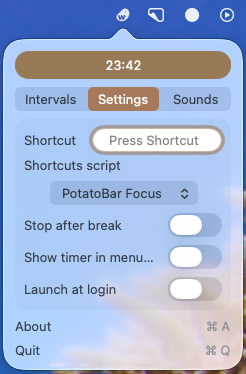
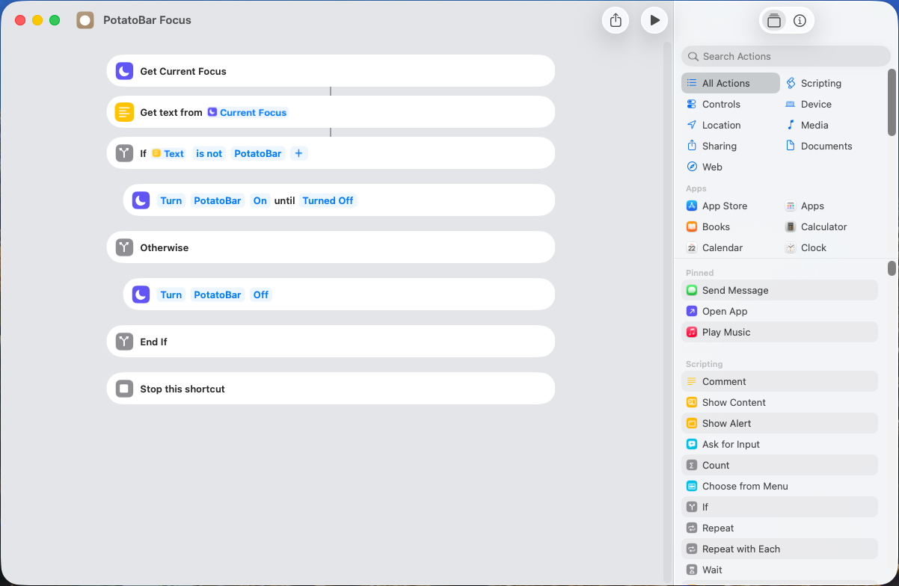
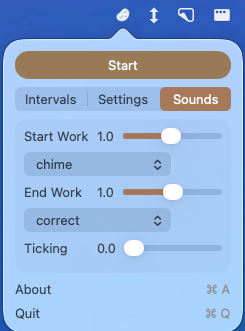

    

 
<h1 align="center">PotatoBar</h1>

    

## Overview
PotatoBar is a customized version of the world's neatest Pomodor timer for the macOS menu bar, <a href="https://github.com/ivoronin/TomatoBar">TomatoBar</a>! Any and all credit for this tool should go over there.

## PotatoBar Features

### Shortcuts Integration

If you create a shortcut in the <a href="https://support.apple.com/guide/shortcuts-mac/intro-to-shortcuts-apdf22b0444c/mac">Shortcuts</a> app, you can select in the settings and it will be called every time the work interval starts and stops. In this example shortcut below, I added a new focus setting called "PotatoBar", which will turn on when the work interval starts and stopped when the work interval ends.

### More sounds!

Change the "start work" and "end work" sounds in the Sounds tab.

#### Sound sources:

- [attention](https://pixabay.com/sound-effects/musical-attention-chime-123107/)
- [bell](https://pixabay.com/sound-effects/film-special-effects-bell-sound-effect-613873/)
- [chime](https://pixabay.com/sound-effects/film-special-effects-chime-sound-7143/)
- [correct](https://pixabay.com/sound-effects/technology-correct-472358/)
- [futuristic](https://pixabay.com/sound-effects/technology-deep-ui-chime-585839/)
- [level-up](https://pixabay.com/sound-effects/film-special-effects-level-up-191997/)

## Licenses
 - Timer sounds are licensed from buddhabeats
